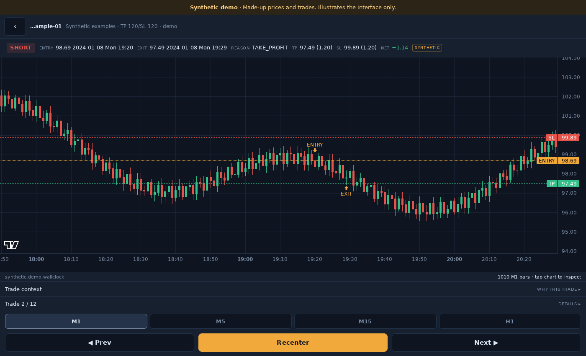

# Trading Research Suite

A place to test trading ideas and look closely at what happened.

The **Research Engine** runs experiments, simulates trades, and keeps the details
needed to revisit a result. The **Trade Explorer** brings those results onto a
chart, so you can move from an experiment to an individual trade and inspect its
entry, exit, and surrounding price action.

## What you can do

- Turn a trading idea into a repeatable experiment.
- Compare runs and inspect where results differ.
- Browse trades on a chart, including entries, exits, stops, and targets.
- Add your own research methods as the project grows.

## Take a look

[Try the demo](docs/GETTING_STARTED.md#try-the-explorer) ·
[Run your own research](docs/GETTING_STARTED.md#use-your-own-data) ·
[Explore the documentation](docs/README.md)

The demo uses made-up prices and trades. They illustrate the interface and say
nothing about how a strategy would perform in a real market.

This is a research project under active development. It helps you investigate
ideas and understand their limitations; simulation results are not promises of
future returns.
