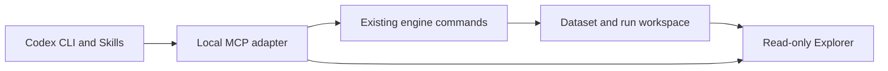

# Codex integration: first release plan

Status: mapping and specification complete; integration not implemented.

## The first working experience

A user installs the suite, connects it to Codex CLI, and asks for a small research
experiment. The engine runs it locally, the assistant explains the recorded
results, and the user opens the actual trades in the Explorer.

The first working slice uses generated synthetic data and one existing research
template. Personal-data import and a downloadable dataset catalog follow that
slice and remain requirements for the broader release.

## What exists and what is missing

| Component | Current state | Remaining work |
| --- | --- | --- |
| Research engine | Strict configurations, features/models/policies, evaluations, simulation, immutable run records, verification | A supported user-facing example that runs without private data |
| Engine commands | `run`, `status`, `list`, `verify`, index/query/compare commands | A small, validated tool adapter; no generic shell or arbitrary-code tool |
| Background execution | Detached whole-run workers, heartbeat and terminal states | Setup checks and an end-to-end disconnect test on the supported platform |
| Explorer | Real result readers, run overview, trade charts and timeframes | Start/configure it for the user's workspace and publish the completed run to its index |
| Existing synthetic demo | Generated in-memory prices and trades for UI preview | It is not a research run and cannot stand in for the engine example |
| MCP server | Absent | Local stdio server with explicit tool schemas and errors |
| Codex plugin and Skills | Absent | Package, local marketplace entry, installation instructions, workflow Skills |
| Personal data | Engine accepts admitted, manifest-backed datasets | Guided import, column/time interpretation, validation and admission |
| Downloadable catalog | Absent | Approved packages, catalog metadata, integrity checks and download/install flow |

The existing example configurations reference external datasets. Engine tests
already construct synthetic catalogs and execute real pipelines, but those test
helpers are not a supported installation or demonstration API.

## Proposed boundaries

The adapter is an external integration package, outside
`src/trading_research/`. The engine remains the execution authority and the
Explorer remains a reader. The adapter must not become a second simulator,
evaluation implementation, run-state authority or job scheduler.

Use the engine's JSON command interfaces for execution and indexing. Use
supported read interfaces for observations. Any missing public boundary must be
documented and covered by an ADR before implementation; do not reach into
private helpers simply because tests use them. No existing architecture guard
needs to be relaxed for this plan.

### Important details found in the code

- **A chart needs actual simulation output.** The Explorer lists completed runs
  with `policy_execution_count > 0`, not every descriptive or forecast-only run.
  The example must produce TradeLog artifacts. Forecast evaluation and simulation
  results must retain their separate meanings.
- **Status is not automatically read-only.** The existing engine `status` and
  `list` commands call a reconciling scan that can terminalize stale runs.
  A tool advertised as read-only must use an established non-mutating path, such
  as `scan_runs(..., reconcile=False)`, rather than those commands. Index rebuild
  already scans without reconciliation and writes only the derived index.
- **Background execution currently targets Linux.** Workers use `systemd-run
  --user` with a `tmux` fallback; other paths use `fcntl`. Start with Linux and
  Codex CLI. Windows, WSL and macOS compatibility require separate validation.
- **The installed plugin is not necessarily a Git checkout.** Canonical runs
  require a clean recorded repository and its engine lockfile. Provision a
  version-pinned suite checkout separately from plugin caches and keep generated
  data/configurations/results outside it. A wheel or ZIP without Git evidence
  must not fabricate a commit or be presented as canonical.
- **Read results from files.** SQLite is a disposable listing accelerator. The
  assistant must preserve dataset identity, run/fold references and recorded
  cost limitations when explaining results.

## Initial MCP tools

These are proposed names, not commands available today.

| Tool | Purpose | Effects |
| --- | --- | --- |
| `research_capabilities` | Report supported templates, setup and limits | Read-only |
| `research_datasets` | List admitted datasets and administrative metadata | Read-only; no market rows |
| `research_prepare` | Build and validate a bounded experiment from an existing template | Write a plan in the user workspace; no run registration |
| `research_start` | Start the exact prepared plan | Register and launch an engine run |
| `research_status` | Read recorded state, heartbeat and available progress | Read-only; no reconciliation |
| `research_results` | Return bounded recorded results and an Explorer link | Read-only; no evaluation or index rebuild |

For the first slice, `research_prepare` accepts only the bundled synthetic
template and its documented bounded parameters. It returns the normalized plan,
dataset identity, code/lock identities and declared execution limits. Parsing a
valid JSON configuration alone must not be reported as a full runtime preflight.
`research_start` checks that the prepared inputs still match before launch.

The launch sequence must prevent duplicate tool retries from silently starting
additional attempts. Keep an atomic request-to-run record outside the checkout;
an uncertain launch is reported as uncertain and checked before retrying.
The engine's run directory remains authoritative. One active run is the initial
default; wide sweeps and new strategy-code generation are later capabilities.

Index refresh and starting the local Explorer are explicit workspace operations,
outside read-only result tools. Return availability honestly if the viewer is
not running. Bind the viewer to loopback and select an available local port.

## Installation and data

The first supported setup is Codex CLI on Linux, Git and uv-managed Python 3.13.
Verify the detached launcher before offering a long-running experiment. Preserve
the engine and Explorer's separate environments and pinned lockfiles. The user's
existing Codex authentication is used by Codex; the MCP adapter does not need to
collect an LLM API key.

Package the plugin manifest, MCP launch configuration, and Skills for setup,
planning a research run, and explaining results. Use local plugin distribution
for the first release. Installation/activation must be tested in a fresh Codex
session; command availability alone does not prove that the plugin loads.

The dataset workflow will expose two choices:

1. **Use my data:** a guided importer checks explicit columns and time semantics,
   creates a new dataset identity and reports problems before admission.
2. **Get a dataset:** a configured catalog offers versioned, approved packages;
   downloads verify declared content digests before admission.

Both enter the same engine data layer. Never guess UTC semantics or silently
change timestamps. Downloads use a configured catalog and approved origins,
rather than letting the model fetch arbitrary URLs. Publish only data whose
distribution rights and intended access role have been checked. Storage hosting
is a separate deployment decision; the first slice does not expose a research
server or distribute internal datasets.

The synthetic example gets its own explicit clock domain, deterministic
generator, split policy and manifests. Generation writes a new workspace artifact
and never modifies existing datasets. Research access remains TRAIN-only for
the first slice. OOS/LOCKBOX unlocks are not exposed as tools. Synthetic runs
still use the engine's current unverified execution/cost semantics, with their
synthetic provenance clearly labelled; no new cost-verification claim is made.

## Delivery order and evidence of completion

| Step | Deliverable | Acceptance check |
| --- | --- | --- |
| 0 — this change | Source mapping and this specification | Links and command/interface evidence checked; no integration claimed |
| 1 | Standalone synthetic engine example | Fresh checkout produces a COMPLETE run, real evaluations and TradeLogs; real Explorer opens it |
| 2 | Local MCP adapter | Client discovers tools; prepare/start/status/results work; invalid and repeated requests are handled correctly; reads never mutate run files |
| 3 | Codex plugin and Skills | Fresh Codex session loads the plugin and completes the example through tool calls |
| 4 | Personal import and dataset catalog | Both paths create validated, identity-pinned datasets and run the supported template |
| 5 | Public installation package | A new user completes setup through results using only the published instructions |

The underlying execution must survive closing the MCP client. Tampered dataset
files and changed prepared inputs must be refused. Protected-data paths remain
blocked. The complete existing engine gate remains required; add focused adapter
and installation checks when their implementation exists.

## Current verification and external references

This mapping inspected the actual engine, Explorer and synthetic test paths.
On the development host, Codex CLI 0.163.0 exposes `mcp` and `plugin` commands;
the engine's `run` and `status` command schemas were inspected without executing
a research run. No plugin installation, MCP handshake, new dataset import or
model-driven research has been performed for this planning step.

Implementation references, checked 2026-10-30:

- [Local MCP configuration](https://learn.chatgpt.com/docs/extend/mcp).
- [Plugin packaging and local distribution](https://developers.openai.com/plugins/build/plugins).
- [Plugin installation](https://learn.chatgpt.com/docs/plugins).

Source anchors:

- [Configuration validation](../src/trading_research/experiments/config.py).
- [Execution, status and detached launch](../src/trading_research/experiments/cli.py).
- [Git and lockfile evidence](../src/trading_research/experiments/orchestration.py).
- [Run identity](../src/trading_research/experiments/run_identity.py).
- [Run scans and reconciliation](../src/trading_research/experiments/runs.py).
- [Index operations](../src/trading_research/ops/cli.py) and [non-mutating index source scan](../src/trading_research/index/build.py).
- [Synthetic pipeline tests](../tests/test_experiments.py) and [data fixtures](../tests/load_fixtures.py).
- [Real Explorer listing](../explorer/src/explorer/index_read.py), [API](../explorer/src/explorer/api.py), and [preview-only demo](../explorer/src/explorer/demo.py).
- [Distribution and code identity](adr/ADR-0029-public-suite-distribution.md).
