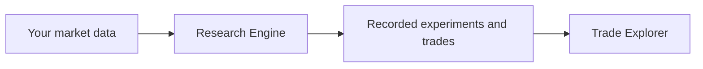

# How it fits together

The Research Engine turns a configured idea and a dataset into a recorded
experiment. The Explorer helps you inspect what that experiment produced.

The engine keeps data, research models, trading decisions, simulation, and
evaluation separate. This lets you investigate different kinds of ideas without
rebuilding the whole system.

The Explorer reads completed results. Its navigation follows the research:
choose a family of experiments, compare its runs, open a run overview, then
inspect individual trades on a chart. It supports M1, M5, M15, and H1 views.

Both components live in this repository. They keep separate Python environments
and dependency lockfiles. The engine lives at the root; the Explorer is in
`explorer/`. Market datasets, generated views, and run artifacts belong outside
the checkout.

## Reproducibility in this distribution

The engine records the commit of the whole suite. A change to the Explorer or
documentation therefore changes the identity of future experiments and their
cache keys. Uncommitted changes make a run noncanonical. This is a deliberate,
conservative choice for this combined distribution; see
[ADR-0029](adr/ADR-0029-public-suite-distribution.md).

The self-contained demo is a separate application that generates illustrative
data in memory. It does not load datasets, discover runs, or execute the engine.
